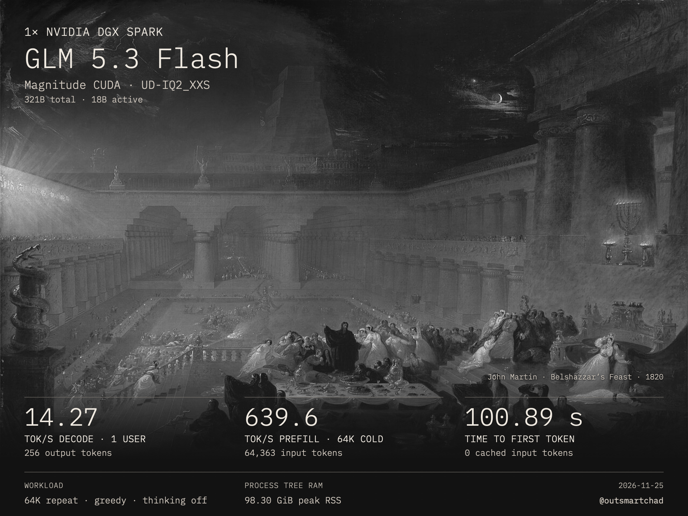

# GLM 5.3 Flash on one DGX Spark with Magnitude

Serve **321B total / 18B active** GLM 5.3 Flash on one 128 GB DGX Spark. The recipe uses Magnitude CUDA, Unsloth UD-IQ2_XXS GGUF and the catalog's embedded MTP head. The text API binds to `127.0.0.1`.



Artwork by John Martin, *Belshazzar’s Feast* (1820). [Source](<https://collections.britishart.yale.edu/catalog/tms:924>)

[Setup and first chat](docs/setup.md) · [How it works](docs/how-it-works.md) · [Benchmark method and raw data](docs/results.md) · [Troubleshooting](docs/troubleshooting.md)

## Performance

Measured November 25, 2026 with one request at a time, a cold 64K text repeat prompt, 256 output tokens, greedy sampling and thinking off.

| Pass | Decode tok/s | Prefill tok/s | TTFT |
| --- | ---: | ---: | ---: |
| 1 | 14.27 | 639.6 | 100.89 s |
| 2 | 13.83 | 643.5 | 100.29 s |
| Median | 14.05 | 641.5 | 100.59 s |

The card pairs the fastest valid decode pass with its prefill and TTFT. Peak sampled process-tree RSS was **98.30 GiB**. See [the full report](docs/results.md) for actual token counts, tuning, cache state and individual draft counters. These figures belong to the 64K repeat workload. The [earlier 1M-context attempt](docs/results.md#earlier-startup-attempts) failed during generation.

## Run it on your Spark

Install [the prerequisites](docs/setup.md#1-check-the-spark) and pause other loaded inference models before serving. Allow about **145 GB** free on SSD for the model, source builds and caches.

```bash
git clone https://github.com/outsmartchad/glm-5-3-flash-single-dgx-spark-magnitude.git
cd glm-5-3-flash-single-dgx-spark-magnitude
./scripts/recipe.py doctor
./scripts/recipe.py prepare
./scripts/recipe.py serve
```

When the serving URL appears, open a second Spark terminal in the checkout and run:

```bash
./scripts/recipe.py smoke
```

Expected reply: `SPARK_OK`. The OpenAI-compatible base URL is `http://127.0.0.1:10100/v1` and the model ID is `glm-5.3-flash:gguf:iq2`. Setup pins the [source](https://github.com/magnitudedev/magnitude/tree/78c92e4f21e38f9528f21e09c5e43936a04b6b0d), [checkpoint](https://huggingface.co/unsloth/GLM-5.3-Flash-GGUF/tree/a38483c8cd5df544f53d70fb281afe97369d5ab6) and CUDA runtime compiler. See [setup](docs/setup.md) for a full API request.

Stop serving with Ctrl-C before starting the measured benchmark.

```bash
./scripts/benchmark.sh
```

[Upstream Magnitude](https://github.com/magnitudedev/magnitude) · [Original model card](https://huggingface.co/zai-org/GLM-5.3-Flash)
